# gatedtrain recipe: LeRobot SmolVLA on LIBERO-Object

This recipe teaches a small vision-language-action robot policy to do LIBERO-Object manipulation tasks, and lets
[gatedtrain](https://github.com/gatedtrain/gatedtrain) decide whether the trained policy really is better than the one
it started from. LeRobot 0.7.0 fine-tunes the action expert of `lerobot/smolvla_base` (expert-only SFT, batch 32,
`n_action_steps` 50) on the 454 LIBERO-Object demonstrations of `lerobot/libero`, in two stages: a stage-1 ladder from
`smolvla_base` picks the base cut by a pre-registered rule, then a stage-2 run starts from that cut. gatedtrain gates
stage 2's last cut against the stage-1 cut on 400 held-out (task, initial state) items of the LIBERO simulator, two
seeds each, by a rule registered before training.

A recipe is a ready-made external run for gatedtrain: the training code with its locked environment, plus an
*adapter*, the small plugin through which gatedtrain reads the run's outputs. gatedtrain does not start the training;
you run it.

This is a prototype: the result below is one registered run, not a benchmark claim.

## How it works

```mermaid
flowchart LR
    fetch["fetch_models.py, export_frames.py:<br/>smolvla_base and LIBERO-Object demos, pinned"] --> s1["train_lerobot_logged.py in a container:<br/>stage 1 ladder from smolvla_base"]
    s1 --> rule["Pre-registered rule picks the base cut:<br/>first cut with probe success in 0.2 to 0.6"]
    rule --> s2["train_lerobot_logged.py in a container:<br/>stage 2 from the base cut"]
    s2 --> cuts["Stage 2 cuts and<br/>per-sample log"]
    cuts --> eval["eval_libero.py: base cut and last cut<br/>in the LIBERO simulator, 400 items x 2 seeds"]
    rule --> eval
    eval --> arms["Arm files: success per item"]
    arms --> collect["gatedtrain ext-collect"]
    cuts -->|"read through the adapter lerobot_smolvla"| collect
    collect --> gate{"Gate"}
    gate --> report["Gate report, consumption ledger"]
```



`gatedtrain ext-launch` checks the run request and prints the container command; you run it. The steps, flags and
arm files are explained in gatedtrain's [External runs](https://gatedtrain.github.io/gatedtrain/external-runs/) guide.

## Result

One registered run: stage 2 is 2,500 steps at batch 32 from the stage-1 cut `checkpoint-500` (0.40 GPU-hours). The
gate's deciding metric is `success` (LIBERO's goal check) on 400 items, two seeds each:

| | `success` |
|---|---|
| Base (stage-1 `checkpoint-500`) | 0.2175 |
| Trained (stage-2 `checkpoint-2500`) | 0.445 |
| Gate | **PASS** under the original registration: +0.2275, 95% cluster-bootstrap interval [0.186, 0.270] |

The scorer and runtime pins changed after the gate ran (publication cleanup and renames). Re-judged with gatedtrain
0.3.0 under the amended registration, the gate reports INCONCLUSIVE with reason `post_hoc`, with every statistic equal.
The PASS verdict is that of the original registration.

`RESULT.md` has the full record: the registration, power, overlap with training, the impact query, the CPU probe, the
amendments and a known limitation. The gate files are under `results/2026-11-16/`.

## Container image

`container/Containerfile` builds `gatedtrain-a8-runtime:1` `FROM gatedtrain-a5-runtime:1`, a local tag that is not pulled
from any registry: it is the runtime image of the SD3.5 OCR recipe (`gatedtrain-recipe-flow-grpo-sd35-ocr`), whose
`container/Containerfile` is copied to `container/Containerfile.a5` here (its instructions byte for byte)
(`FROM docker.io/nvidia/cuda:13.0.3-devel-ubuntu24.04`, pinned by digest, plus X11/GL libraries from an Ubuntu
snapshot). Build that image first, then this one (both in `container/`):

```bash
docker build --network host -t gatedtrain-a5-runtime:1 -f Containerfile.a5 .
docker build --network host -t gatedtrain-a8-runtime:1 -f Containerfile .
```

This image adds only the EGL/OpenGL/OSMesa libraries (same Ubuntu snapshot) and the glvnd vendor file; Python and the
runtime venv are mounted read-only from the host. The adapter pins the image id the published result ran with
(`adapter.py` `IMAGE`); a rebuild gets a new id. The published run's images were built under the project's earlier
tags `ptc-a5-runtime:1` and `ptc-a8-runtime:1`, and their RUN instructions write the package lists
`/etc/ptc-a5-packages.txt` and `/etc/ptc-a8-packages.txt`: those file names are kept so that the instructions stay
byte-identical to the ones that built the pinned images.

## Setup

```bash
pip install "gatedtrain @ git+https://github.com/gatedtrain/gatedtrain@v0.3.0"   # the framework, at the release this recipe was tested with
pip install -e .                      # the adapter, into the environment that runs gatedtrain
cd runtime && uv sync --frozen        # the training and evaluation environment (LeRobot 0.7.0, LIBERO, torch)
```

The adapter finds the runtime at `runtime/` of its source tree (or `GATEDTRAIN_RECIPE_LEROBOT_SMOLVLA_LIBERO_RUNTIME`), mounts it
read-only at its own path, and reads the interpreter tree from `runtime/.venv/pyvenv.cfg`; the runs' outputs go under the
host's gatedtrain output root (`<output_root>/lerobot-smolvla-libero`). `runtime/README.md` has the commands, mounts, profiles
and the decisions behind the metric. The recipe locates `runtime/` from its source tree, so with a non-editable install
(a wheel) set `GATEDTRAIN_RECIPE_LEROBOT_SMOLVLA_LIBERO_RUNTIME` to a checkout's `runtime/` directory.

Downloads: `runtime/fetch_models.py --accept-libero-assets-terms` (see the warning under "Data and licenses": without
the flag the script refuses, because the simulator assets state no license).

## Layout

| Path | What |
|---|---|
| `src/gatedtrain_recipe_lerobot_smolvla_libero/` | the gatedtrain adapter `lerobot_smolvla` (`adapter.py`) and its registry rows (`rows.py`), registered through the `gatedtrain.adapters` entry point |
| `runtime/` | what runs in the container: the training launcher `train_lerobot_logged.py`, the evaluator `eval_libero.py`, their shared `a8_common.py`, the download script `fetch_models.py` with its pin manifest `MANIFEST.json`, the frame export `export_frames.py` (its `frames/frames_meta.json`), the registered item sets (`items-gate/`, `items-probe/`, `ITEMS-MANIFEST.json`), the CPU and render probes (`verify_cpu.py`, `probe_render.py`), host tests (`tests/`), and its own `pyproject.toml` and `uv.lock` |
| `container/Containerfile` | the runtime image `gatedtrain-a8-runtime:1` (EGL/OSMesa libraries on top of the SD3.5 recipe's image `gatedtrain-a5-runtime:1`) |
| `container/Containerfile.a5` | the base image `gatedtrain-a5-runtime:1`, a copy of the SD3.5 OCR recipe's `container/Containerfile` (instructions byte-identical) |
| `tests/` | the adapter's tests on fixture runs (no simulator or GPU needed) and gatedtrain's conformance check |
| `results/2026-11-16/` | the gate files of the published result (`gate/`) and the CPU probe P0 results (`verify/`), host paths redacted to `<data-root>/...` (see `RESULT.md`) |

Not committed (regenerated): the venv (`uv sync --frozen` in `runtime/`), the models, the dataset and the LIBERO assets
(`runtime/fetch_models.py`: `models/`, `data/`, `assets/`, `hf-meta/`, `hf-home/`), the LIBERO configuration
(`verify_cpu.py config` writes `libero-config/config.yaml`) and the frame export's shards (`export_frames.py` writes
`frames/*.jsonl`; `frames/frames_meta.json` is committed and binds them).

## Trust

LIBERO loads its packaged initial-state files with `torch.load(..., weights_only=False)` (pickle), and LeRobot loads
the policy checkpoints the evaluator is given. Use the simulator package from the pinned `runtime/uv.lock`, and load
only checkpoints you produced (or otherwise trust).

## Tests

```bash
python -m unittest discover -s tests -t tests
```

Without a runtime venv the tests run on a stand-in runtime (`tests/_lerobot.py`). The real-file tests read the runtime
and, with `GATEDTRAIN_RECIPE_LEROBOT_SMOLVLA_LIBERO_OUTPUTS` naming the directory of the GPU runs `base-1/` and
`base-1-eval2-500/` (and the runtime override naming the runtime they used), the real outputs; they skip where absent.

The runtime notes, code comments, gate files and test registration template cite the maintainers' decision
record ("Area 8 (VLA) decisions", "Area 8 probes P1/P2", "Area 8 base cut", "Area 8 result"): that record is not
published, and neither are the framework's review rounds the code comments cite ("Review 9 M1").

## Data and licenses

> **Warning: the LIBERO simulator assets carry no stated license.** `lerobot/libero-assets` (the meshes and textures the
> LIBERO simulator loads; evaluation needs them) has no dataset card license and no license file, and it contains
> scanned objects, HOPE and TurboSquid meshes, which may be under their own, possibly restrictive, terms. They are not
> redistributed here. `runtime/fetch_models.py` downloads them only with the explicit flag
> `--accept-libero-assets-terms` and refuses without it. Check the terms that apply to your use before passing the
> flag; you are responsible for that use.

Nothing below is committed here except small metadata (see `THIRD_PARTY_NOTICES.md`); `runtime/fetch_models.py`
downloads each repository at the pinned 40-hex revision and `runtime/MANIFEST.json` checks every file by SHA-256.

| What | Source @ revision | License (as stated upstream) |
|---|---|---|
| SmolVLA base policy | `lerobot/smolvla_base` @ `5e8d12a6e2975b0e5e5fce7c8caf47c371d257b6` (SmolVLA, arXiv 2506.01844) | Apache-2.0 (model card) |
| VLM backbone files | `HuggingFaceTB/SmolVLM2-500M-Video-Instruct` @ `4cde9d208e19519c36917aa170fffc7e381aa0ad` (arXiv 2504.05299) | Apache-2.0 (model card) |
| Training data (LIBERO-Object demonstrations) | `lerobot/libero` (dataset) @ `a1aaacb7f6cd6ee5fb43120f673cebb0cfea7dd4` | Apache-2.0 (dataset card) |
| Simulator assets | `lerobot/libero-assets` (dataset) @ `0b3ea86be5fe169d0fd036ae63d1070ec09e90f6` (scanned objects, HOPE and TurboSquid meshes) | none stated: the repository has no card and no license file; not redistributed here, check the terms before use |
| Simulator and benchmark | LIBERO, `hf-libero` 0.1.4 (huggingface/LIBERO @ `8561c60eea2fb93096146f240194649df73d8b1e`; Liu et al., "LIBERO: Benchmarking Knowledge Transfer for Lifelong Robot Learning") with robosuite 1.4.0 and MuJoCo 3.8.1 | MIT (LIBERO `LICENSE`) |
| Training framework | LeRobot 0.7.0 (huggingface/lerobot, commit `410c095eacc0011d998a73383eb94abed2715af0`), used as a dependency, not copied | Apache-2.0 (`LICENSE`) |
| Base image | `docker.io/nvidia/cuda:13.0.3-devel-ubuntu24.04` (through the SD3.5 OCR recipe's image) | NVIDIA CUDA license terms of the image; Ubuntu packages under their own licenses |

## License

Licensed under the Apache License, Version 2.0 (`LICENSE`); see `NOTICE`. Third-party material in this repository
(small metadata files and test fixtures derived from LIBERO, `lerobot/libero`, SmolVLA and SmolVLM2) is listed with its
source and license in `THIRD_PARTY_NOTICES.md`. Models, datasets and simulator assets are not redistributed; their
licenses are listed above.

Names of third-party projects and products are trademarks of their owners; this project is not affiliated with or
endorsed by them.
